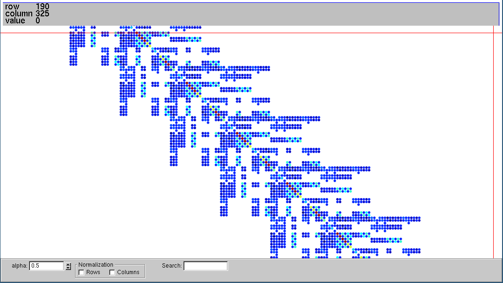
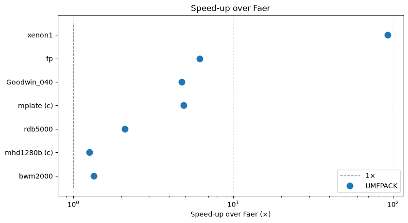

# Russell Sparse - Sparse matrix calculations and solvers for linear systems <!-- omit from toc --> 

[](https://docs.rs/russell_sparse/)

_This crate is part of [Russell - Rust Scientific Library](https://github.com/cpmech/russell)_

## Contents <!-- omit from toc --> 

- [Introduction](#introduction)
  - [Complex Numbers Support](#complex-numbers-support)
  - [Documentation](#documentation)
- [Installation](#installation)
  - [Setting Cargo.toml](#setting-cargotoml)
  - [Optional features](#optional-features)
- [Performance](#performance)
- [🌟 Examples](#-examples)
  - [Solve a tiny sparse linear system using the Faer solver](#solve-a-tiny-sparse-linear-system-using-the-faer-solver)
  - [Solve a complex sparse linear system using the Faer solver](#solve-a-complex-sparse-linear-system-using-the-faer-solver)
  - [Iterative solvers](#iterative-solvers)
- [Tools](#tools)
- [MUMPS + OpenBLAS issue](#mumps--openblas-issue)
  - [References](#references)
- [For developers](#for-developers)

## Introduction

This library implements tools for handling sparse matrices and functions to solve sparse linear systems with six backends:
* **Faer** - pure-Rust sparse LU (always available)
* **Iterative** - pure-Rust Krylov solvers with algebraic multigrid (limited; see below)
* **BasicLU** - pure-Rust LU with rank-1 updates for square general systems, written for LP bases (always available)
* **QDLDL** - pure-Rust `L D L^T` factorization of the upper triangle for symmetric quasi-definite systems (always available)
* [UMFPACK](https://github.com/DrTimothyAldenDavis/SuiteSparse) - Highly recommended for general sequential use
* [MUMPS](https://mumps-solver.org) - For very large systems, supporting multithreaded execution

> **The native iterative solvers are limited.** With the default algebraic-multigrid settings they
> reach a relative error of 1e-6 on a minority of the real SuiteSparse matrices measured in
> [benchmark-russell](https://github.com/cpmech/benchmark-russell): BiCGStab on 12 of 33, GMRES on 7,
> and CG on 1, since CG requires a symmetric positive definite matrix. The setup and the kernels are
> tested -- what is limited is how often the preconditioner makes the iteration converge. For
> production work use **Faer**, **UMFPACK** or **MUMPS**, and use the iterative path where it has
> been measured to converge on your own matrix.

Some performance benchmarks are available here:
- [benchmark-russell](https://github.com/cpmech/benchmark-russell) Performance benchmarks for the `Russell` project

### Complex Numbers Support

This crate fully supports both real (`f64`) and complex (`Complex64`) numbers. You can use the complex variants of the data structures and solvers, such as `ComplexCooMatrix` and `ComplexSolverUMFPACK`, seamlessly.

The crate also ships pure-Rust iterative solvers: preconditioned conjugate gradients (CG), BiCGStab, and restarted GMRES, with either algebraic multigrid (AMG) or identity preconditioning. They need no external library and are available in every build, but their convergence is matrix-dependent -- see the limitation above.

This library implements three storage formats for sparse matrices:

* COO: COOrdinates matrix, also known as a sparse triplet.
* CSC: Compressed Sparse Column matrix
* CSR: Compressed Sparse Row matrix

Additionally, to unify the handling of the above sparse matrix data structures, this library implements:

* SparseMatrix: Either a COO, CSC, or CSR matrix

The COO matrix is the best when we need to update the values of the matrix because it has easy access to the triples (i, j, aij). For instance, the repetitive access is the primary use case for codes based on the finite element method (FEM) for approximating partial differential equations. Moreover, the COO matrix allows storing duplicate entries; for example, the triple `(0, 0, 123.0)` can be stored as two triples `(0, 0, 100.0)` and `(0, 0, 23.0)`. Again, this is the primary need for FEM codes because of the so-called assembly process where elements add to the same positions in the "global stiffness" matrix. Nonetheless, the duplicate entries must be summed up at some stage for the linear solver (e.g., MUMPS, UMFPACK). These linear solvers also use the more memory-efficient storage formats CSC and CSR. See the [russell_sparse documentation](https://docs.rs/russell_sparse) for further information.

This library also provides functions to read and write Matrix Market files containing (huge) sparse matrices that can be used in performance benchmarking or other studies. The [read_matrix_market()] function reads a Matrix Market file and returns a [CooMatrix]. To write a Matrix Market file, we can use the function [write_matrix_market()], which takes a [SparseMatrix] and, thus, automatically converts COO to CSC or COO to CSR, also performing the sum of duplicates. The `write_matrix_market` also writes an SMAT file (almost like the Matrix Market format) without the header and with zero-based indices. The SMAT file can be given to the fantastic [Vismatrix](https://github.com/cpmech/vismatrix) tool to visualize the sparse matrix structure and values interactively; see the example below.



### Documentation

* [](https://docs.rs/russell_sparse/) — [russell_sparse documentation](https://docs.rs/russell_sparse/)
* See also a [paper concerning some caveats with the sparse solvers (freely available)](https://onlinelibrary.wiley.com/doi/10.1002/nme.7545).


## Installation

The default build needs no external library: the sparse solver is pure Rust (the Faer backend). The optional `umfpack` and `mumps` features link external solvers, and `open_blas`/`intel_mkl` accelerate the dense kernels; [the main README file](https://github.com/cpmech/russell) has the installation steps for each platform.

### Setting Cargo.toml

[](https://crates.io/crates/russell_sparse)

👆 Check the crate version and update your Cargo.toml accordingly:

```toml
[dependencies]
russell_sparse = "*"
```

### Optional features

The following optional (Rust) features are available:

* `open_blas`: Use OpenBLAS for the dense kernels (needs its development headers)
* `intel_mkl`: Use Intel oneAPI MKL for the dense kernels; takes precedence over `open_blas` when both are enabled
* `umfpack`: Add UMFPACK (SuiteSparse) as a sparse direct solver; a local install under `RUSSELL_LOCAL_PREFIX` takes precedence over the package-manager library
* `mumps`: Add MUMPS as a sparse direct solver; requires a locally compiled MUMPS under `RUSSELL_LOCAL_PREFIX` (Linux, macOS, and Windows with the GNU toolchain)

UMFPACK is optional and off by default. With `umfpack`, the build first checks for a local install at `$RUSSELL_LOCAL_PREFIX/include/umfpack` and `$RUSSELL_LOCAL_PREFIX/lib/umfpack`. If that installation is not there — or `RUSSELL_LOCAL_PREFIX` is unset — it falls back to the system library found with `pkg-config` (or the usual include/library directories), and fails as usual if neither is available. The local installation therefore takes precedence, and a build links only one of the two sources. The default build uses the Faer solver; enable `umfpack` to add UMFPACK. On Windows the sources differ by toolchain: the GNU toolchain uses the MSYS2 package (through `MSYS2_PREFIX`), and the MSVC toolchain uses a vcpkg install (`VCPKG_ROOT` or `VCPKG_INSTALLATION_ROOT`). MUMPS needs the GNU toolchain there: its Windows build is MinGW objects plus gfortran, which MSVC cannot link.

MUMPS is independent of UMFPACK and always comes from `RUSSELL_LOCAL_PREFIX`, which must then be set and exported. The layout is fixed:

```text
$RUSSELL_LOCAL_PREFIX/include/umfpack     $RUSSELL_LOCAL_PREFIX/lib/umfpack
$RUSSELL_LOCAL_PREFIX/include/mumps       $RUSSELL_LOCAL_PREFIX/lib/mumps
```

A prefix that is set but does not contain UMFPACK produces a build warning and the system fallback; a missing MUMPS install fails the build naming the path it expected. The directory of the selected UMFPACK must also be reachable by the dynamic loader at run time, since the two SuiteSparse builds share the `libsolver.so.6` soname.

The [main README file](https://github.com/cpmech/russell) has the installation steps for each platform.


### WebAssembly

With the default features (Faer solver, no external libraries) the crate builds for `wasm32-unknown-unknown` and `wasm32-wasip1`. On the browser target the Matrix Market and JSON file helpers compile but return errors, since there is no filesystem; WASI provides one when the runtime preopens a directory. A smoke test preprocesses and solves a small system on the browser target, where there is neither a clock nor a filesystem, so the Faer path is exercised there rather than only compiled.

## Performance

The `Faer` solver (`Genie::Faer`) is the pure-Rust sparse solver, using `FaerMethod::Simplicial` by default. Note that `algebra_linear`'s supernodal path (`FaerMethod::Supernodal`) omits contribution blocks between supernodes and instead updates each front directly from the stored `L` and `U` columns, so large fronts are slower than simplicial. The table below compares the default simplicial path with UMFPACK on the SuiteSparse benchmark matrices that completed; the data is from [benchmark-russell](https://github.com/cpmech/benchmark-russell).

| Matrix | NROW | NNZ | Faer | UMFPACK | UMFPACK / Faer |
| --- | ---: | ---: | ---: | ---: | ---: |
| bwm2000 | 2,000 | 7,996 | 1.08 ms | 0.750 ms | 1.44× faster |
| mhd1280b (c) | 1,280 | 22,778 | 0.740 ms | 0.383 ms | 1.93× faster |
| rdb5000 | 5,000 | 29,600 | 35.2 ms | 13.6 ms | 2.59× faster |
| mplate (c) | 5,962 | 142,190 | 3.12 s | 627 ms | 4.97× faster |
| Goodwin_040 | 17,922 | 561,677 | 508 ms | 107 ms | 4.75× faster |
| fp | 7,548 | 848,553 | 942 ms | 154 ms | 6.10× faster |
| xenon1 | 48,600 | 1,181,120 | 55.0 s | 598 ms | 92× faster |

`(c)` marks a complex-valued matrix; rows are sorted by NNZ. **NNZ is the matrix-file non-zero count.** Times are outlier-free averages on the benchmark machine (Arch Linux, Intel Core i9-13900KF): 5 runs for UMFPACK, and for Faer 3 runs on the fast/medium matrices (`<= 30 s`) and 1 run on `xenon1`.

The Faer solver is fast on small systems: up to about 30,000 non-zeros it takes at most a few tens of milliseconds. It becomes very slow for matrices with more than **1 million** non-zeros: the `xenon1` case (NROW=48,600, 1,181,120 non-zeros) takes **55.0 s**, and matrices above 1.2 million pattern entries (starting with `twotone`, NROW=120,750, 1,224,224 non-zeros) are skipped by default in the benchmark harness. For matrices with more than **1 million** non-zeros, expect **nearly a minute** or more.

The threshold is not a function of NNZ alone. The complex `mplate` (NROW=5,962, 142,190 non-zeros) takes **3.12 s**, and `RFdevice` (NROW=74,104, 365,580 non-zeros) did not finish within the **3-minute** probe; sparsity structure and numerical type matter as much as the non-zero count.

UMFPACK is faster than the Faer solver on every matrix in the table; the gap grows with the fill-in, reaching **92×** on `xenon1`. The figure below shows the same ratios on a log scale (the dashed line is 1×):



## 🌟 Examples

This section illustrates how to use `russell_sparse`. See also:

* [More examples in the documentation](https://docs.rs/russell_sparse/)
* [Examples directory](https://github.com/cpmech/russell/tree/main/russell_sparse/examples)


### Solve a tiny sparse linear system using the Faer solver

```rust
use russell_lab::{vec_approx_eq, Vector};
use russell_sparse::prelude::*;
use russell_sparse::StrError;

fn main() -> Result<(), StrError> {
    // constants
    let ndim = 3; // number of rows = number of columns
    let nnz = 5; // number of non-zero values

    // allocate solver
    let mut solver = SolverFaer::new()?;

    // allocate the coefficient matrix
    let mut coo = CooMatrix::new(ndim, ndim, nnz, Sym::No)?;
    coo.put(0, 0, 0.2)?;
    coo.put(0, 1, 0.2)?;
    coo.put(1, 0, 0.5)?;
    coo.put(1, 1, -0.25)?;
    coo.put(2, 2, 0.25)?;

    // print matrix
    let a = coo.as_dense();
    let correct = "┌                   ┐\n\
                   │   0.2   0.2     0 │\n\
                   │   0.5 -0.25     0 │\n\
                   │     0     0  0.25 │\n\
                   └                   ┘";
    assert_eq!(format!("{}", a), correct);

    // call preprocess
    solver.preprocess(&coo, None)?;

    // allocate two right-hand side vectors
    let b = Vector::from(&[1.0, 1.0, 1.0]);

    // calculate the solution
    let mut x = Vector::new(ndim);
    solver.solve(&mut x, &b, false)?;
    let correct = vec![3.0, 2.0, 4.0];
    vec_approx_eq(&x, &correct, 1e-14);
    Ok(())
}
```

### Solve a complex sparse linear system using the Faer solver

```rust
use russell_lab::{complex_vec_approx_eq, cpx, ComplexVector};
use russell_sparse::prelude::*;
use russell_sparse::StrError;

fn main() -> Result<(), StrError> {
    let ndim = 3;
    let nnz = 7;

    // allocate solver
    let mut solver = ComplexSolverFaer::new()?;

    // allocate the coefficient matrix
    //   ┌                      ┐
    //   │  2+1i  -1-1i     0   │
    //   │ -1-1i   2+2i  -1+1i  │
    //   │   0    -1+1i   2-1i  │
    //   └                      ┘
    let mut coo = ComplexCooMatrix::new(ndim, ndim, nnz, Sym::No)?;
    coo.put(0, 0, cpx!(2.0, 1.0))?;
    coo.put(0, 1, cpx!(-1.0, -1.0))?;
    coo.put(1, 0, cpx!(-1.0, -1.0))?;
    coo.put(1, 1, cpx!(2.0, 2.0))?;
    coo.put(1, 2, cpx!(-1.0, 1.0))?;
    coo.put(2, 1, cpx!(-1.0, 1.0))?;
    coo.put(2, 2, cpx!(2.0, -1.0))?;

    // call preprocess
    solver.preprocess(&coo, None)?;

    // right-hand side vector
    let b = ComplexVector::from(&[cpx!(-3.0, 3.0), cpx!(2.0, -2.0), cpx!(9.0, 7.0)]);

    // calculate the solution
    let mut x = ComplexVector::new(ndim);
    solver.solve(&mut x, &b, false)?;

    // check the result
    let correct = &[cpx!(1.0, 1.0), cpx!(2.0, -2.0), cpx!(3.0, 3.0)];
    complex_vec_approx_eq(&x, correct, 1e-14);
    Ok(())
}
```

See [russell_sparse documentation](https://docs.rs/russell_sparse) for more examples.

See also the folder `examples`.

### Iterative solvers

Select an iterative method with `Genie::Iterative(IterativeMethod::{Cg, BiCgStab, Gmres})`. All three use algebraic multigrid (AMG) preconditioning by default, or the identity preconditioner. Their parameters live in `LinSolParams::iterative`: tolerance, absolute tolerance, maximum number of iterations, GMRES restart, number of threads, AMG coarsening, smoother, coarse-enough size, and maximum number of levels.

```rust
use russell_lab::{vec_approx_eq, Vector};
use russell_sparse::prelude::*;
use russell_sparse::StrError;

fn main() -> Result<(), StrError> {
    // ┌             ┐
    // │  4 -1    0  │
    // │ -1  4   -1  │
    // │  0 -1    4  │
    // └             ┘
    let ndim = 3;
    let mut coo = CooMatrix::new(ndim, ndim, 7, Sym::YesFull)?;
    coo.put(0, 0, 4.0)?;
    coo.put(0, 1, -1.0)?;
    coo.put(1, 0, -1.0)?;
    coo.put(1, 1, 4.0)?;
    coo.put(1, 2, -1.0)?;
    coo.put(2, 1, -1.0)?;
    coo.put(2, 2, 4.0)?;

    // solve with conjugate gradients
    let mut solver = SolverIterative::new(IterativeMethod::Cg)?;
    solver.preprocess(&coo, None)?;
    let rhs = Vector::from(&[3.0, 2.0, 3.0]);
    let mut x = Vector::new(ndim);
    solver.solve(&mut x, &rhs, false)?;
    vec_approx_eq(&x, &[1.0, 1.0, 1.0], 1e-10);

    // print the iterative statistics
    let mut stats = StatsLinSol::new();
    solver.update_stats(&mut stats);
    let iterative = stats.iterative_stats.as_ref().expect("iterative statistics");
    println!("method = {}", iterative.method);
    println!("preconditioner = {}", iterative.preconditioner);
    println!("iterations = {:?}", iterative.iterations_array);
    println!("relative residual = {:?}", iterative.relative_residual_array);
    println!("AMG levels = {}", iterative.amg_levels);
    Ok(())
}
```

If the method does not converge within the iteration limit, `solve` returns `"the iterative solver did not converge"` after storing the report in the statistics. The identity preconditioner (`params.iterative.preconditioner = Preconditioner::Identity`) is the escape hatch for nonsymmetric systems when the AMG setup is unsuitable.


## Tools

This crate includes a tool named `solve_matrix_market` to study the performance of the available sparse solvers (Faer, BasicLU, QDLDL, the iterative solvers, MUMPS, and UMFPACK).

`solve_matrix_market` reads a [Matrix Market file](https://math.nist.gov/MatrixMarket/formats.html) and solves the linear system:

```text
A ⋅ x = b
```

where the right-hand side (b) is a vector containing only ones.

The data directory contains an example of a Matrix Market file named `bfwb62.mtx`, and you may download more matrices from https://sparse.tamu.edu/

For example, run the command:

```bash
cargo run --release --bin solve_matrix_market -- ~/Downloads/matrix-market/bfwb62.mtx
```

Or

```bash
cargo run --release --bin solve_matrix_market -- --help
```

to see the options.

The default solver of `solve_matrix_market` is Faer. Use the `--genie` (`-g`) flag to select another backend: `faer`, `cg`, `bicgstab`, `gmres`, `basiclu`, `qdldl`, `mumps`, or `umfpack`:

```bash
cargo run --release --bin solve_matrix_market -- -g mumps ~/Downloads/matrix-market/bfwb62.mtx
```

Use `--faer-method <auto|simplicial|supernodal>` (and `--faer-flop-ratio <f>` with `auto`) to select the Faer LU strategy.

The iterative solvers are configured with the following options, which `faer`, `basiclu`, `qdldl`, `mumps`, and `umfpack` ignore (`--help` prints the defaults, which live in the binary):

| Option | Meaning |
| --- | --- |
| `--iter-tol` | Relative residual tolerance |
| `--iter-abs-tol` | Absolute residual tolerance |
| `--iter-max` | Maximum number of Krylov iterations |
| `--iter-precond` | Preconditioner: `amg` or `identity` |
| `--iter-restart` | GMRES restart dimension (GMRES only) |
| `--iter-threads` | Number of threads for the Krylov and AMG kernels |
| `--iter-min-parallel-len` | Minimum vector length before threads are used |
| `--amg-coarsening` | `ruge-stuben`, `aggregation`, or `smoothed-aggregation` |
| `--amg-smoother` | `gauss-seidel`, `damped-jacobi`, `ilu0`, `chebyshev`, `spai0`, or `spai1` |
| `--amg-coarse-enough` | AMG size at which the coarsest level is solved directly |
| `--amg-max-levels` | Maximum number of AMG levels |
| `--amg-max-memory-mb` | Maximum memory budget in MiB for AMG and Krylov (`0` = unlimited) |

The output looks like this:

```json
{
  "main": {
    "platform": "Russell",
    "blas_lib": "OpenBLAS",
    "solver": "MUMPS-local"
  },
  "matrix": {
    "name": "bfwb62",
    "nrow": 62,
    "ncol": 62,
    "nnz": 202,
    "complex": false,
    "symmetric": "YesLower"
  },
  "requests": {
    "ordering": "Auto",
    "scaling": "Auto",
    "mumps_num_threads": 0
  },
  "output": {
    "effective_ordering": "Amf",
    "effective_scaling": "RowColIter",
    "effective_mumps_num_threads": 1,
    "openmp_num_threads": 24,
    "umfpack_strategy": "Unknown",
    "umfpack_rcond_estimate": 0.0
  },
  "determinant": {
    "mantissa_real": 0.0,
    "mantissa_imag": 0.0,
    "base": 2.0,
    "exponent": 0.0
  },
  "verify": {
    "max_abs_a": 0.0001,
    "max_abs_ax": 1.0000000000000004,
    "max_abs_diff": 5.551115123125783e-16,
    "relative_error": 5.550560067119071e-16
  },
  "time_human": {
    "read_matrix": "43.107µs",
    "initialize": "266.59µs",
    "preprocess": "196.81µs",
    "solve": "166.87µs",
    "total_ifs": "630.27µs",
    "verify": "2.234µs"
  },
  "time_nanoseconds": {
    "read_matrix": 43107,
    "initialize": 266590,
    "preprocess": 196810,
    "solve": 166870,
    "total_ifs": 630270,
    "verify": 2234
  },
  "mumps_stats": {
    "inf_norm_a": 0.0,
    "inf_norm_x": 0.0,
    "scaled_residual": 0.0,
    "backward_error_omega1": 0.0,
    "backward_error_omega2": 0.0,
    "normalized_delta_x": 0.0,
    "condition_number1": 0.0,
    "condition_number2": 0.0
  }
}
```


## MUMPS + OpenBLAS issue (retired in 5.4.0)

Older OpenBLAS builds made MUMPS "very, very slow" when the number of OpenMP threads was left automatic,
so `russell_sparse` used to force `ICNTL(16) = 1` whenever Intel MKL was not detected (References #1 and
#2, the latter stating on page 72: _"We have observed that multi-threading of OpenBLAS library in MUMPS
leads to multiple thread conflicts which sometimes result in significant slow-down of the solver."_).

That guard was removed in **5.4.0**, together with `LinSolParams::mumps_override_prevent_nt_issue_with_openblas`
and the `--override-prevent-issue` flag: with the thread-safe MUMPS build the combination is measured, not
assumed. On a 62 500-unknown 2-D Laplacian, pinned to eight cores, gfortran + OpenBLAS MUMPS (median of
three runs each):

| `ICNTL(16)` | `OPENBLAS_NUM_THREADS` | time |
|---|---|---|
| 1 (what the guard enforced) | 8 | 0.206 s |
| 1 | 1 | 0.205 s |
| 0 (automatic, what removal gives) | 8 | 0.193 s |
| 8 | 8 | 0.191 s |
| 8 | 1 | 0.191 s |

Correctness was checked on the same build: the internal team is right at `ICNTL(16)` = 2, 4 and 8; 32 plain
OS caller threads run 20 lifecycles each cleanly at `OMP=8` and `16` with the internal team on; and `pmsim`'s
driver specifications agree with the guarded build to `1.2e-11` relative on the physical columns (bit-identical
at one thread).

If an OpenBLAS build on another machine still shows the old slow-down, the workaround needs no special
field: set `LinSolParams.mumps_num_threads = 1`, or `OPENBLAS_NUM_THREADS=1`, so that only one of the two
libraries threads at a time.

## References

1. Pedroso DM (2024) [Caveats of three direct linear solvers for finite element analyses](https://onlinelibrary.wiley.com/doi/10.1002/nme.7545), _International Journal for Numerical Methods in Engineering_, doi.org/10.1002/nme.7545.
2. Dorozhinskii R (2019) [Configuration of a linear solver for linearly implicit time integration and efficient data transfer in parallel thermo-hydraulic computations](https://mediatum.ub.tum.de/doc/1486743/1486743.pdf). _Master's Thesis in Computational Science and Engineering._ Department of Informatics Technical University of Munich.


## For developers

* The `c_code` directory contains a thin wrapper to the sparse solvers (MUMPS, UMFPACK)
* The `build.rs` file uses the crate `cc` to build the C-wrappers
* The `zscripts` directory also contains the following:
    * `memcheck.bash`: Checks for memory leaks on the C-code using Valgrind
    * `run-examples`: Runs all examples in the `examples` directory
    * `run-solve-matrix-market.bash`: Runs the solve-matrix-market tool from the `bin` directory
